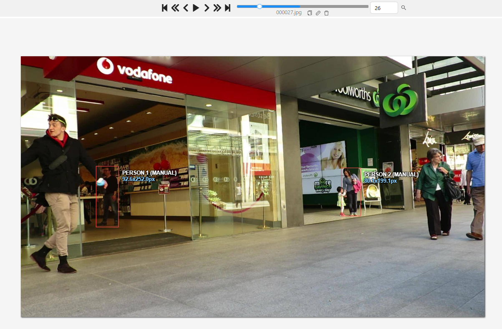
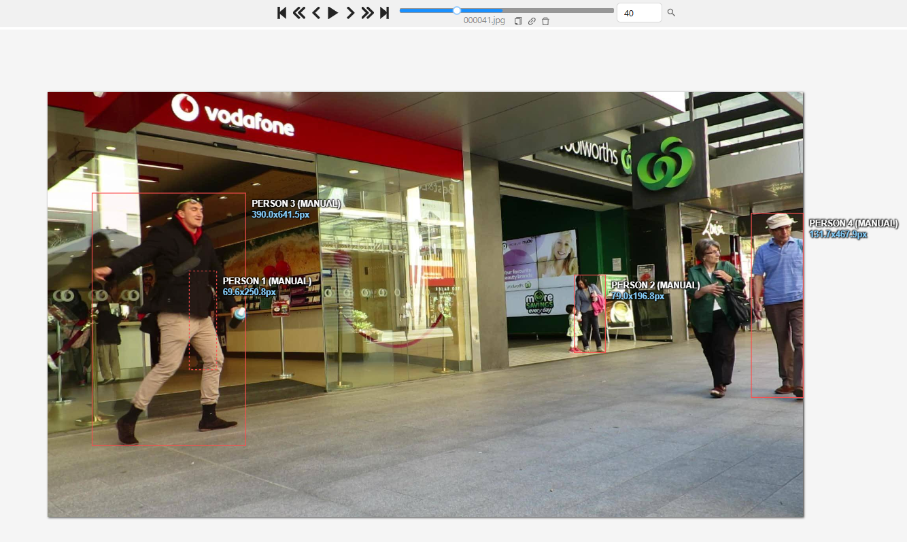
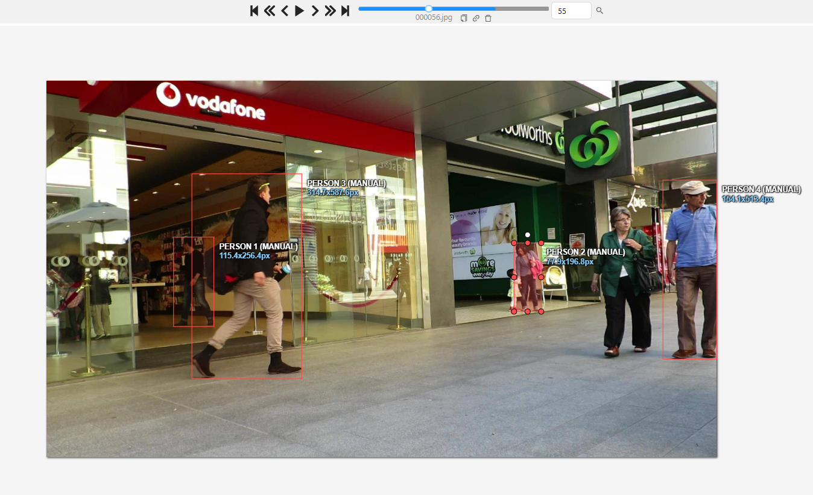

# Báo cáo cá nhân — BuiThiThuong-2A202603136

Đoạn video: MOT17-09, 150 frame (frame 1–150), nguồn MOTChallenge, giấy phép CC BY-NC-SA 3.0.

## 0. Thông tin học viên

- Họ tên: Bùi Thị Thường
- MSSV: 2A202603136
- Mã đề (A/B/C): C
- Email: viewer1102@gmail.com
- Link repository: https://github.com/viewer1102/K5-L2A-BuiThiThuong-2A202603136-Day05-MOTTracking
- Giờ bắt đầu: 21h
- Giờ kết thúc: 23h12

## 1. Xem trước đoạn video (CP0)

Ghi **trước khi vẽ**, mỗi người một dòng.

| Mã | Frame xuất hiện | Frame cuối thấy được | Rẽ / dừng / đổi tốc độ ở frame | Bị che ở frame | Ghi chú |
|---|---|---|---|---|---|
| P1 | 0 | 149 | | 27 -> 54 | |
| P2 | 45 | 149 | | 60 -> 70 | |
| P3 | 23 | 149 | | | |
| P4 | 0 | 104 | | 94 -> 104 | |
| P5 | 10 | 134 | | 114 -> 134 | |

## 2. Keyframe và thời gian (CP1, CP4)

Số keyframe lấy từ kết quả `src/check_submission.py`.

| Mã | Số keyframe | Keyframe ở frame | Số frame có mặt | Keyframe / 100 frame | Thời gian (phút) | Chỗ khó |
|---|---|---|---|---|---|---|
| P1 | 33 | 0, 12, 17, 23, 27, 28, 33, 34, 35, 38, 39, 50, 53, 54, 55, 60, 64, 65, 75, 80, 85, 91, 95, 100, 110, 111, 118, 120, 127, 135, 139, 144, 149| 141 | 23.4 | | |
| P2 | 10 | 61, 71, 91, 110, 111, 120, 127, 135, 139, 149| 89 | 11.2 | | |
| P3 | 23 | 40, 50, 54, 60, 70, 75, 80, 85, 90, 95, 118, 120, 124, 128, 132, 133, 135, 136, 138, 140, 141, 144, 149| 110 | 20.9 | | |
| P4 | 5 | 	2, 12, 39, 80, 94| 103 | 4.9| | |
| P5 | 36 | 28, 29, 30, 31, 32, 34, 35, 36, 37, 38, 39, 40, 43, 47, 54, 55, 58, 62, 67, 73, 78, 81, 83, 85, 91, 93, 100, 105, 108, 110, 111, 114, 117, 127, 130, 134| 98 | 36.7| | |
| **Tổng** | 107 | | 541 | 19.8 | 132 | |

107 ÷ 541 × 100 = 19,8 keyframe / 100 frame

Bạn đặt keyframe nhiều nhất ở người nào? Vì sao (người đó rẽ, dừng, lại gần camera hay bị che)?
=> P5 có nhiều keyframe nhất (36). Vì người đó xoay người bước dài đi nhanh nên phải chỉnh vị trí và kích thước box ở nhiều frame liên tiếp do box nội suy hơi lệch
...

## 3. Đoạn bị che (CP2)

Người bị che: `P1`

| Mốc | Frame |
|---|---:|
| Bắt đầu bị che một phần (bật `occluded`) | 27 |
| Mất hẳn (bật `outside`) | 41 |
| Hiện lại (tắt `outside`) | 50 |
| Thấy rõ trở lại (tắt `occluded`) | 55 |

- Thời gian khuất hẳn: 9 frame (41->49) = 0.3 giây.
- Quyết định: giữ cùng ID.
- Lý do: khuất 9 frame ngắn hơn so với ngưỡng 60 frame, xuất hiện lại ngoại hình có khớp, đúng hướng và tốc độ

Ảnh chụp màn hình:

## 4. Tự review ID (CP3)

Đã kiểm hai lượt, không lỗi.

## 5. File xuất và kết quả tự kiểm (CP4)

| Kiểm tra | Kết quả |
|---|---|
| Tên file MOT 1.1 | BuiThiThuong_mot.zip |
| Tên file CVAT for video 1.1 | BuiThiThuong_cvat_video.zip |
| Số track ID khác nhau trong `gt/gt.txt` (phải là 5) | 5|
| Frame `outside` không có dòng trong `gt.txt` (đúng / sai) | đúng |
| Job đã completed trên CVAT máy cá nhân | |

Dán phần tóm tắt in ra từ `src/check_submission.py`:

=== Tóm tắt ===
  Lỗi: 0   |   Cảnh báo: 0

## 6. Ba câu kết

1. Nếu được gán lại, bạn sẽ đặt keyframe khác ở đâu? Vì sao?

   => Em sẽ đặt mốc sát các đoạn đổi hướng và trước/sau lúc bị che, rồi kiểm tra đoạn giữa. Ở đoạn đi đều, em sẽ kiểm tra cả đoạn nội suy trước khi thêm mốc cho từng sai lệch nhỏ.

2. Có chỗ nào bạn không chắc "cùng ID hay ID mới"? Bạn đã quyết định và ghi chú thế nào?

   => Với P1, bản MOT giữ ID 1 sau khoảng trống 9 frame, dưới ngưỡng 60 frame của bài. Cần đối chiếu ảnh để mô tả dấu hiệu nhận diện khi hiện lại.

3. Một lỗi ID trong job của bạn (nếu không còn sót, chọn lỗi đã sửa) có thể làm xe tự lái dự đoán sai chuyển động của người đó như thế nào? Lỗi đó ảnh hưởng MOTA hay IDF1 nhiều hơn?

   => job không có lỗi ID, nhưng nếu giả sử P1 sau khi bị che khuất ở frame 41 và hiện lại ở frame 50 mà bị track bám nhầm sang người khác và lỗi kéo dài qua nhiều frame, IDF1 thường bị ảnh hưởng rõ hơn vì danh tính bị gán sai trong cả đoạn. MOTA cũng giảm do có lỗi đổi ID.

## 7. Tài liệu tham khảo và công cụ AI đã dùng
- MOTChallenge, chuỗi MOT17-09.
- CVAT, gán track và xuất nhãn.
- ChatGPT, hỗ trợ đối chiếu số liệu trong bản xuất MOT